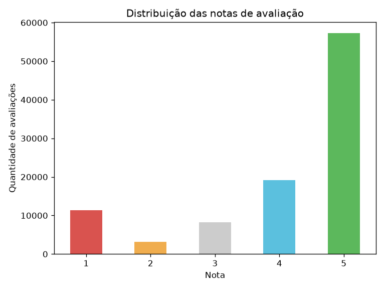
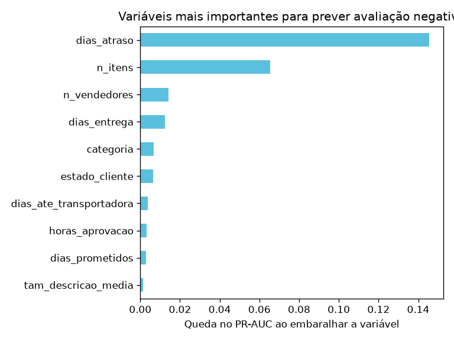

# Prevendo avaliações negativas em um e-commerce brasileiro

> **Dá para identificar, logo após a entrega e antes de o cliente avaliar, quais pedidos têm alta chance de receber nota 1 ou 2, para o atendimento agir a tempo?**

Projeto de ciência de dados de ponta a ponta com dados reais de cerca de 100 mil pedidos do e-commerce brasileiro Olist: exploração, construção de variáveis sem vazamento de dados, modelagem e recomendações de negócio.

## Resumo

- **14,7%** das avaliações são negativas (notas 1 e 2).
- **Atraso é o fator mais forte:** pedidos atrasados têm **62%** de avaliações negativas, contra **9%** dos pedidos entregues no prazo (**~6,7x**).
- Mesmo assim, **68% das avaliações negativas acontecem em pedidos entregues no prazo**. Por isso um modelo que combine vários fatores é necessário.
- O modelo final (gradient boosting) aponta uma lista de ~630 pedidos em que **58% realmente recebem avaliação negativa**, contra 9,7% de uma escolha aleatória: o atendimento fica **~6x mais eficiente** ao decidir quem contatar.

---

## 1. Problema de negócio

Uma avaliação negativa prejudica a reputação da loja e do vendedor e costuma indicar um cliente que não volta a comprar. Quando ela chega, o problema já aconteceu.

**Objetivo:** estimar, para cada pedido entregue, a probabilidade de ele receber uma avaliação negativa, para que a equipe de atendimento possa **priorizar contatos proativos** (pedido de desculpas, cupom, resolução de pendências) antes de o cliente avaliar.

## 2. Dados

Base pública [Brazilian E-Commerce Public Dataset by Olist](https://www.kaggle.com/datasets/olistbr/brazilian-ecommerce), com pedidos feitos entre 2016 e 2018, distribuída em várias tabelas relacionadas:

| Tabela | Conteúdo | Linhas |
|---|---|---|
| `orders` | Pedidos e datas (compra, aprovação, envio, entrega, prazo prometido) | 99.441 |
| `order_reviews` | Avaliações dos clientes (nota de 1 a 5 e comentário) | 99.224 |
| `order_items` | Itens de cada pedido (produto, vendedor, preço, frete) | 112.650 |
| `customers` | Localização dos clientes | 99.441 |
| `products` | Categoria e características dos produtos | 32.951 |
| `sellers` | Localização dos vendedores | 3.095 |
| `order_payments` | Forma de pagamento e parcelas | 103.886 |

**Qualidade dos dados:** 768 pedidos não têm avaliação e 547 pedidos têm mais de uma. Para manter **uma linha por pedido**, foi usada apenas a avaliação mais recente.

## 3. Principais achados da exploração



- **A base é desbalanceada:** 85% das avaliações não são negativas. Um modelo que dissesse sempre "não vai ser negativa" teria cerca de 85% de acurácia sem aprender nada. Por isso a avaliação usa **precisão, recall e PR-AUC**, e não acurácia.
- **Atraso:** 62% de avaliações negativas nos pedidos atrasados, contra 9% nos pedidos no prazo.
- **Tempo total de entrega:** a taxa de avaliações negativas sobe de 8% (entrega em até 7 dias) para 65% (mais de 30 dias).
- **Número de vendedores:** pedidos com 2 ou mais vendedores têm 47% de avaliações negativas, contra 12% com um vendedor. Nos comentários desses pedidos, **68%** falam de produto faltando ("apenas recebi 1", "veio incompleto"), contra 28% nos demais. A causa principal é a **entrega parcial**: cada vendedor envia um pacote separado, e o cliente avalia antes de receber tudo.
- **Número de itens:** a taxa vai de 11% (1 item) para 31% (3 itens ou mais).

## 4. Metodologia

### 4.1 Momento da previsão e vazamento de dados

O ponto mais importante do projeto é definir **quando o modelo será usado**:

```
COMPRA ──► APROVAÇÃO ──► ENVIO ──► ENTREGA ──► ★ ──► CLIENTE AVALIA
                                               │
                                O modelo faz a previsão aqui
```

Só entram no modelo informações que **já existem no momento ★**. Dados gerados pela própria avaliação, como o comentário do cliente e a data da resposta, foram excluídos. Usá-los seria **vazamento de dados**: o modelo pareceria excelente no teste, mas seria inútil na prática.

### 4.2 Escopo e alvo

- **Escopo:** 95.824 pedidos com status "entregue" e data de entrega registrada. Pedidos cancelados ou não entregues ficaram de fora, porque nesses casos o problema já é evidente (78% deles têm avaliação negativa).
- **Alvo:** `negativa = 1` quando a nota é 1 ou 2. A taxa no escopo é de **12,8%**.

### 4.3 Variáveis criadas (24)

| Grupo | Variáveis |
|---|---|
| Prazos | dias de entrega, dias prometidos, dias de atraso, se atrasou, horas até a aprovação, dias até a transportadora |
| Calendário | mês e dia da semana da compra |
| Pedido | nº de itens, nº de produtos, nº de vendedores, valor total, frete total, frete sobre o valor, peso total |
| Produto | média de fotos, tamanho médio da descrição, categoria |
| Pagamento | nº de parcelas, nº de formas de pagamento, forma de pagamento |
| Localização | estado do cliente, estado do vendedor, se são do mesmo estado |

### 4.4 Separação temporal de treino e teste

Os pedidos foram ordenados pela data da compra: os **80% mais antigos** formam o treino e os **20% mais recentes** formam o teste (corte em 27/05/2018). Isso simula o uso real, em que o modelo é treinado com o passado e aplicado em pedidos novos, e evita que ele "veja o futuro" durante o treino.

| Conjunto | Pedidos | Taxa de avaliações negativas |
|---|---|---|
| Treino | 76.659 | 13,6% |
| Teste | 19.165 | 9,7% |

### 4.5 Modelos

- **Regressão logística** (modelo base): preenchimento de valores faltantes, padronização e one-hot encoding em um `Pipeline` do scikit-learn.
- **Gradient boosting** (`HistGradientBoostingClassifier`): trata valores faltantes e categorias nativamente.
- Em ambos, `class_weight="balanced"` compensa o desbalanceamento das classes.

## 5. Resultados

### 5.1 Desempenho no conjunto de teste

| Modelo | ROC-AUC | PR-AUC | Precisão* | Recall* |
|---|---|---|---|---|
| Acaso (referência) | 0,50 | ~0,10 | ~10% | — |
| Regressão logística | 0,693 | 0,278 | 31,8% | 34,3% |
| **Gradient boosting** | **0,699** | **0,318** | 31,2% | 36,9% |

\* Classe "avaliação negativa", com corte de probabilidade em 0,5.

### 5.2 Escolhendo o ponto de corte

Quem define o corte é o negócio: se o atendimento tem capacidade limitada, ele prefere uma lista menor e mais certeira.

| Corte | Pedidos alertados | Precisão | Recall |
|---|---|---|---|
| 0,5 | 2.196 | 31,2% | 36,9% |
| 0,6 | 1.393 | 40,6% | 30,5% |
| 0,7 | 867 | 51,2% | 23,9% |
| **0,8** | **628** | **58,0%** | 19,6% |

Com corte em 0,8, **mais da metade dos pedidos alertados realmente recebe avaliação negativa**, cerca de **6 vezes** a taxa de uma escolha aleatória (9,7%).

### 5.3 Variáveis mais importantes



Importância medida por **permutação**: quanto o PR-AUC piora quando cada variável é embaralhada.

1. **Dias de atraso**, com grande vantagem sobre as demais
2. **Número de itens**
3. **Número de vendedores**
4. **Dias de entrega**

**Hipótese x resultado:** antes de modelar, a expectativa era que dias de atraso, dias de entrega e número de vendedores fossem as três mais importantes. O modelo confirmou atraso e vendedores, mas colocou o **número de itens em 2º lugar**: mais itens significam mais chances de um deles faltar ou dar problema, e isso atinge muito mais pedidos (13% têm 2 ou mais itens) do que os de múltiplos vendedores (1,3%). O tempo de entrega caiu para 4º porque conta quase a mesma história que o atraso.

## 6. Recomendações ao negócio

1. **Contato proativo:** priorizar o atendimento dos pedidos atrasados e dos pedidos com maior probabilidade de avaliação negativa segundo o modelo.
2. **Entregas parciais:** em pedidos com vários itens ou vendedores, avisar o cliente de que os produtos podem chegar separados, ou enviar a pesquisa de satisfação só depois da última entrega.
3. **Prazos realistas:** revisar os prazos prometidos, já que o atraso em relação ao prometido é o fator mais forte.

## 7. Limitações e próximos passos

- **Limitações:** muitas avaliações negativas dependem de fatores que não estão na base, como qualidade do produto, item diferente do anunciado ou embalagem danificada. Por isso o desempenho é moderado, e o modelo deve ser usado para **priorizar** contatos, e não como verdade absoluta.
- **Próximos passos:**
  - incluir o histórico de avaliações de cada vendedor e produto, calculado só com dados anteriores a cada pedido;
  - testar um modelo para o **momento da compra**, que permitiria agir antes mesmo do envio;
  - ajustar hiperparâmetros com validação cruzada temporal;
  - estimar o impacto financeiro do contato proativo (custo do contato x valor de um cliente retido).

## 8. Como reproduzir

Requisitos: Python 3.11.

1. Clone este repositório e entre na pasta do projeto.
2. Baixe a base no [Kaggle](https://www.kaggle.com/datasets/olistbr/brazilian-ecommerce) e extraia os 9 arquivos CSV em `data/raw/`.
3. Crie o ambiente e instale as dependências:

```bash
python -m venv .venv
.venv\Scripts\activate        # Windows
# source .venv/bin/activate   # Linux/macOS
pip install -r requirements.txt
```

4. Execute os notebooks na ordem:
   - `notebooks/01_exploracao.ipynb`: exploração e hipóteses
   - `notebooks/02_features.ipynb`: construção da base do modelo (gera `data/processed/base_modelo.csv`)
   - `notebooks/03_modelagem.ipynb`: treino, avaliação e importância das variáveis

## 9. Estrutura do projeto

```
olist-avaliacao-negativa/
├── data/
│   ├── raw/                 # CSVs originais do Kaggle (não versionados)
│   └── processed/           # base do modelo gerada pelo notebook 02 (não versionada)
├── notebooks/
│   ├── 01_exploracao.ipynb
│   ├── 02_features.ipynb
│   └── 03_modelagem.ipynb
├── reports/figures/         # gráficos usados neste README
├── requirements.txt
└── README.md
```

## 10. Tecnologias

Python · pandas · NumPy · scikit-learn · Matplotlib · Jupyter

## Autor

**Igor Bicalho**, cientista de dados
[LinkedIn](https://www.linkedin.com/in/igorcbicalho)

*Dados: Olist, disponibilizados publicamente no Kaggle.*
